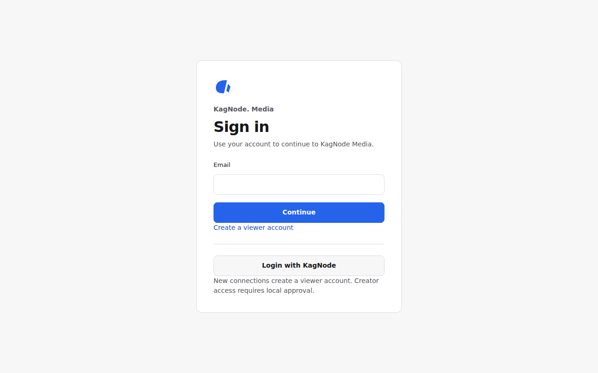
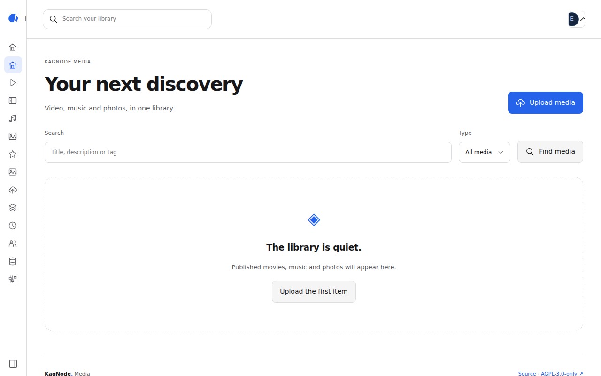
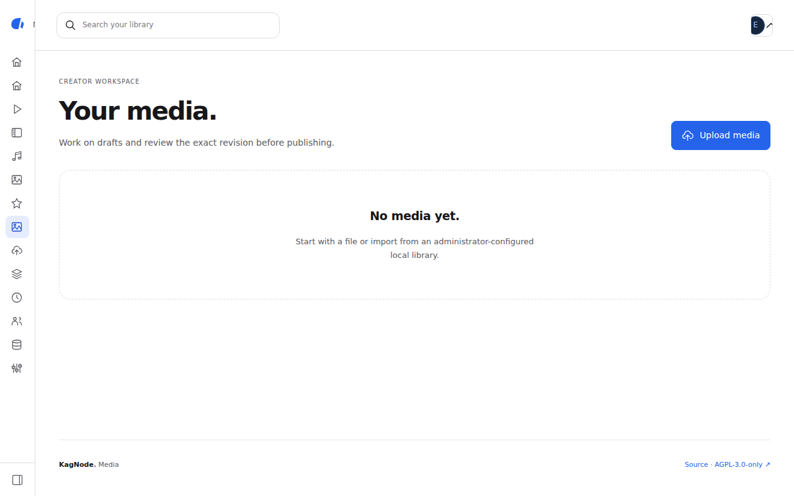
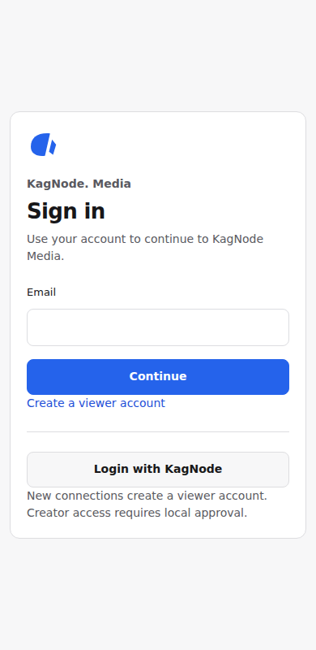

<p align="center"></p>

# KagNode Media

## Overview

Source preview of self-hosted video, audio, photo and album publishing.

### What it looks like

Screenshots come from an isolated test instance with one test administrator and an **empty library**: nothing was uploaded or processed, so no video, music or photo appears. The pages show the interface a person sees before publishing.

| Sign in                                                                    | Library                                                                                           |
| -------------------------------------------------------------------------- | ------------------------------------------------------------------------------------------------- |
|                                  |  |
|  |                                       |

### How it works

1. **Three kinds of account.** Viewers browse and play, creators upload, and administrators review. Publishing is review-based: a creator works on a draft and reviews the exact revision before it goes live.
2. **Uploads can resume.** A large file is sent in chunks, so an interrupted upload continues instead of starting again. An administrator can also configure a local library for import.
3. **A separate worker processes media.** Conversion runs in its own persistent worker, with bounded jobs that can be cancelled, so the web server stays responsive.
4. **Delivery is access-controlled.** The catalog is browsable, playback progress is remembered, and files are served only to people allowed to see them.
5. **Sign-in stays local.** Local sign-in always works. Optional KagNode Account linking syncs your display name and photo after you approve it, and the local administrator can turn it off.
6. **Preview status.** Media is a source preview. The screenshots do not show transcoding, which has not been qualified here.

## Release status

Product source: **5.0.3**. Stable source/data release: **5.0.3**.

KagNode 5 uses the same locally served Core login frame and action icons across applications. Existing local sign-in, explicit KagNode connection, profile-sync policy, local roles and storage formats are preserved. The stable assets are reviewed source/data packages. Media remains source-only for this rollout; no production worker, transcoding or hardware qualification is claimed.

Earlier packaging prereleases remain available. The 5.0 stable release is limited to the verified source/data and web-interface scope; native and hardware evidence remains separate. See [verification](docs/VERIFICATION.md) and [changelog](CHANGELOG.md).

Browser sign-in now returns from KagNode to this application in the same tab, using a one-use authorization code with S256 PKCE. Local email/username forms reveal the password step after identity entry; vault setup, MFA and key-only controls preserve their existing requirements. See [account sign-in](docs/ACCOUNT-SYNC.md).

## Features

Shared Core controls and locally authorized update summaries are integrated where the application supports automatic UI updates. Embedded or account-free products do not invent automatic update events.

- Shared local sign-in and explicit Login with KagNode; local access and security requirements stay available. See [account sign-in](docs/ACCOUNT-SYNC.md).

- Viewer, creator and administrator accounts with review-based publishing.
- Resumable uploads, catalog browsing, access-controlled delivery and playback progress.
- Separate persistent processing worker with bounded jobs and cancellation.

Optional KagNode Account linking syncs your display name and photo after explicit approval. Your local application administrator can disable it. Local sign-in and permissions stay independent.

## Requirements

Node.js 24, SQLite and filesystem storage. Native media processing requires a compatible FFmpeg build and separate verification.

## Installation and downloads

Download from [GitHub Releases](https://github.com/every-lemon/kagnode-media/releases). Verify `SHA256SUMS` before extracting or installing a package.

| Payload                   | Formats                      | Support                                                        |
| ------------------------- | ---------------------------- | -------------------------------------------------------------- |
| Complete source / artwork | `.tar.xz`, `.tar.gz`, `.zip` | Named top-level directory; manual setup                        |
| Source/data               | `.deb`                       | Source only; does not provision a service                      |
| Source/data               | `.rpm`                       | Rocky Linux 10 source package; no native service qualification |

Source packages install under `/usr/share/kagnode/`; they do not replace an existing application, migrate data, start services or configure networking. See [package details](docs/PACKAGING.md).

## Usage

```sh
npm ci
npm run build
# Configure the server using docs/SETUP.md before starting it.
```

See [operations and existing setup instructions](docs/OPERATIONS.md) for the full workflow and its prerequisites.

## Configuration and storage

Shared presentation uses [KagNode Core](docs/CORE.md), with a pinned local fallback and reviewed server adapters. Compatible stable UI patches have a separate local-administrator policy.

Originals, databases and worker output stay outside public assets. No processing worker or transcoding is started by the preview packages.

## Security

Use HTTPS and least-privilege accounts for hosted services. Keep secrets and user data out of Git. Source/data packages support inspection and manual setup; native service and hardware claims remain limited to recorded verification. See [security guidance](docs/SECURITY.md).

## Development and testing

```sh
npm run check
npm test
npm run build
python3 scripts/repository_check.py
python3 scripts/format_source.py --check
python3 scripts/release.py --output dist/packages
```

Install the formatting dependencies from `requirements-format.txt`. Package building additionally needs `dpkg-deb`, `rpmbuild`, XZ support and, for CLI binaries, Go. Read [the repository map](docs/STRUCTURE.md) before editing generated files.

## Documentation

- [Reviewed local setup](docs/INSTALLER.md)

- [Ecosystem installation and updates](docs/ECOSYSTEM.md)

- [Repository structure](docs/STRUCTURE.md)
- [Operations](docs/OPERATIONS.md)
- [Packages and release process](docs/PACKAGING.md)
- [Verification and limits](docs/VERIFICATION.md)
- [KagNode Account linking](docs/ACCOUNT-SYNC.md)
- [Changelog](CHANGELOG.md)

## Licensing

See [LICENSE](LICENSE) and retained third-party notices. KagNode artwork retains its separate permission and brand policy; the application uses AGPL-3.0-only.
